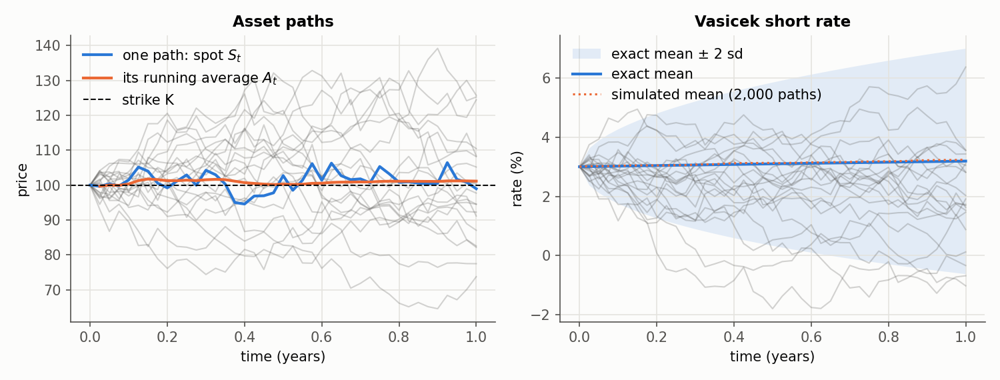
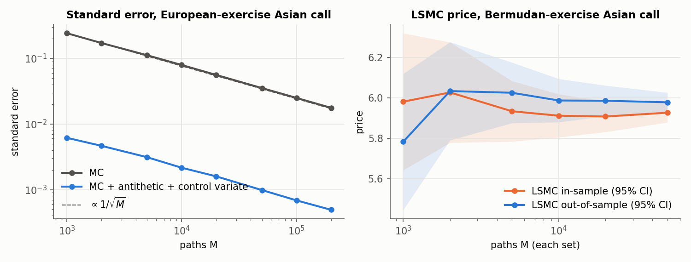
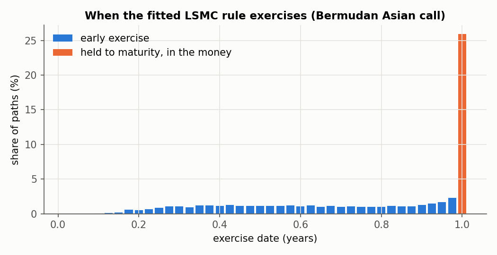
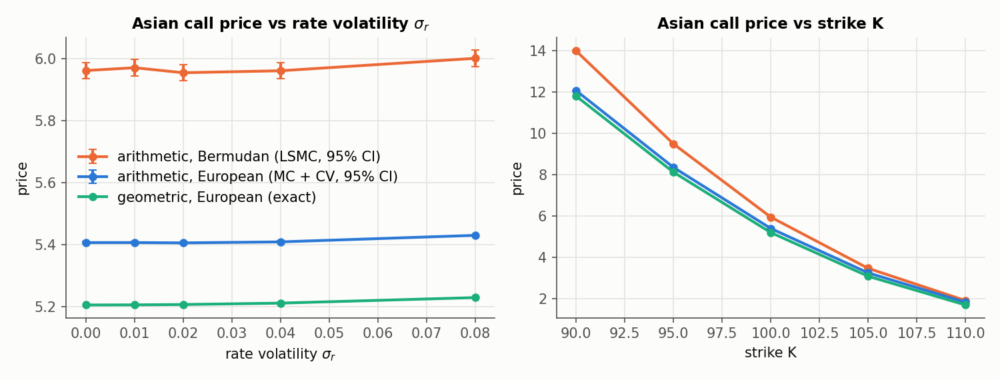
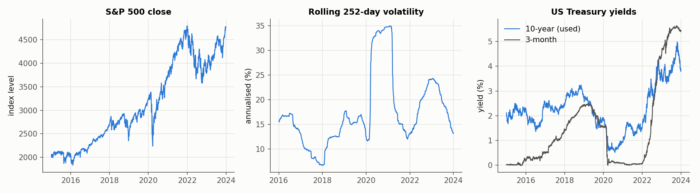

# LSMC pricing of Asian options under Vasicek rates

[](https://github.com/lyujunyang-sys/lsmc-asian-options/actions/workflows/tests.yml)

Reference implementation for the paper *Research on Asian Option Pricing Model Based on Least Squares Monte Carlo Method* (基于最小二乘蒙特卡洛法的亚式期权定价模型研究), Junyang Lyu, *Special Zone Economy* (特区经济), 2026, Issue 4.

It prices arithmetic-average Asian options when the short rate follows a Vasicek model: European exercise by Monte Carlo with variance reduction, and early (Bermudan) exercise by least-squares Monte Carlo (Longstaff and Schwartz, 2001). The empirical part calibrates the model to S&P 500 and US Treasury data for 2015 to 2023.

## What is in it

- **Exact simulation.** Over each time step the short rate, the integral of the rate over the step and the asset's Brownian increment are jointly Gaussian, so paths are sampled with no discretisation error, with any rate/asset correlation. Each path carries its realised discount factor exp(-∫r dt), and payoffs are discounted with it rather than with a flat rate.
- **Closed forms with stochastic rates.** Zero-coupon bond, European option, and the discretely monitored geometric-average Asian option under Vasicek with correlation. They check the simulation and serve as the control variate.
- **Variance reduction.** Antithetic variates, and a control variate (the geometric Asian option on the same paths). Every price comes with its standard error and 95% interval, and the reduction is reported as a factor.
- **LSMC.** Backward induction regressing realised discounted cash flows on polynomials in the state (spot, average to date, short rate), in-the-money paths only. The fitted rule is then applied to independent paths, giving an out-of-sample estimate that is a lower bound up to Monte Carlo error.
- **Calibration.** Vasicek parameters by the exact AR(1) discretisation with parametric-bootstrap standard errors; volatility from rolling 252-day log returns; return/rate correlation.
- **Reproducibility.** Every experiment is a JSON config with its seed (`configs/`); raw data is downloaded by script with a SHA-256 manifest; results, figures and an executed notebook are committed.
- **Tests.** 49 tests, run on Python 3.10 to 3.12 by GitHub Actions (see [Validation](#validation)).

## Quick start

```bash
pip install -e ".[dev,plots,data]"     # or: pip install -r requirements.txt && pip install -e .
pytest                                 # under two minutes
```

```python
import numpy as np
from lsmc_asian import MarketModel, AsianOption, price_european, price_lsmc, geometric_asian_price

m = MarketModel(s0=100, sigma_s=0.20, r0=0.03, kappa=0.10, theta=0.05, sigma_r=0.02, rho=0.0)
call = AsianOption(strike=100, kind="call", average="arithmetic")

eur = price_european(m, call, maturity=1.0, n_steps=40, n_paths=10_000,
                     rng=np.random.default_rng(1), antithetic=True, control_variate=True)
berm = price_lsmc(m, call, maturity=1.0, n_steps=40, n_paths=10_000, rng=np.random.default_rng(2),
                  antithetic=True, n_paths_out_of_sample=10_000, control_variate=True)

print(eur.price, eur.std_error)                                # European exercise
print(berm.out_of_sample.price, berm.out_of_sample.std_error)  # Bermudan exercise
print(geometric_asian_price(m, 100, 1.0, 40))                  # exact geometric benchmark
```

The walkthrough notebook [`notebooks/walkthrough.ipynb`](notebooks/walkthrough.ipynb) goes through the method step by step.

## Reproducing the results

```bash
python scripts/download_data.py          # S&P 500 (Yahoo Finance) + DGS10, DGS3MO (FRED) -> data/raw/, data/manifest.json
python scripts/calibrate.py              # -> data/calibrated/sp500_2015-2023_DGS10.json
python scripts/run_experiment.py configs/*.json   # -> results/<name>/pricing.csv, summary.json ...
python scripts/make_figures.py           # -> results/figures/
```

The calibration file is committed, so every experiment except the data plot runs without downloading anything. All outputs are deterministic given the config seed. Column definitions for every file are in [`docs/data_dictionary.md`](docs/data_dictionary.md).

| Config | What it computes |
| --- | --- |
| `appendix_baseline` | S0 = K = 100, T = 1, 40 dates, the generic parameters of the paper's appendix; calls and puts |
| `paper_table_6_1` | the parameter values of Table 6-1 (S0 = 4000, K = 4050, 252 daily dates) |
| `sp500_calibrated` | all inputs estimated from 2015 to 2023 data, valuation date 2023-12-29 |
| `convergence` | standard error against the number of paths; LSMC against the basis degree |
| `sensitivity` | one-at-a-time changes of sigma_r, kappa, theta, rho and the strike |

## Results

Arithmetic Asian call, one year. "European" exercise pays at maturity only; "Bermudan" may be exercised on any monitoring date and then receives the average to date minus the strike. 10,000 paths per estimate (for LSMC, 10,000 to fit and 10,000 independent paths to value), standard errors in parentheses.

| | Table 6-1 parameters | Calibrated to S&P 500 |
| --- | --- | --- |
| S0 / K | 4000 / 4050 | 4769.83 / 4829.45 |
| sigma_s, r0, kappa, theta, sigma_r, rho | 0.20, 2.5%, 0.10, 2.0%, 0.015, 0 | 0.131, 3.88%, 0.26, 3.05%, 0.0085, 0.19 |
| Arithmetic Asian, European exercise (MC + antithetic + control variate) | 183.10 (0.08) | 159.04 (0.05) |
| Geometric Asian, European exercise (closed form) | 175.77 | 154.65 |
| European call (closed form, Vasicek rates) | 342.00 | 312.53 |
| Arithmetic Asian, Bermudan exercise (LSMC + control variate, out-of-sample) | 202.08 (0.77) | 170.00 (0.56) |

Variance reduction on the European-exercise arithmetic option (same number of paths, `appendix_baseline`):

| Method | Price | Std. error | Variance reduction |
| --- | --- | --- | --- |
| Plain Monte Carlo | 5.371 | 0.0789 | 1 |
| Antithetic | 5.453 | 0.0571 | 1.9 |
| Control variate | 5.406 | 0.0022 | 1,280 |
| Antithetic + control variate | 5.403 | 0.0022 | 1,255 |

The geometric control explains almost all of the variance: for the same accuracy, plain Monte Carlo would need over a thousand times more paths. Full tables, including puts and every method, are in `results/`.







## Validation

The test suite (`tests/`) checks the code against independent results rather than against itself:

- the Longstaff and Schwartz (2001) American put benchmark (S0 = 36, K = 40, r = 6%, sigma = 20%, 50 exercise dates; finite-difference value 4.478), reproduced in and out of sample;
- the closed forms against Black-Scholes and the discrete Kemna-Vorst geometric formula when sigma_r = 0, and against put-call parity with stochastic rates;
- the simulated short-rate mean and variance, bond price, martingale property of the discounted asset, and the full covariance of the integrated rate and the asset's Brownian motion against the analytic expressions;
- Monte Carlo against the closed forms within four standard errors, and arithmetic Asian put-call parity;
- an LSMC call without dividends is not exercised early; Bermudan value at least the European value; the control variate cuts the standard error;
- the calibration recovers known parameters from simulated data and refuses a series without mean reversion;
- every config resolves and a small experiment runs end to end.

## Conventions and modelling notes

- Averages are over the monitoring dates t_i = iT/N, i = 1..N; the initial price is not included.
- Rates are continuously compounded decimals; time is in years; daily data uses 252 steps per year.
- Rate input. Like the paper, the empirical part uses the 10-year Treasury yield. The 3-month yield, the more natural short-rate proxy, trended from 0% to 5.4% over 2015 to 2023 without mean reversion, so Vasicek cannot be fitted to it on this window; `calibrate.py` says so instead of producing a number.
- The mean-reversion speed is weakly identified on nine years of data (kappa = 0.26 with bootstrap standard error 0.50). The sensitivity study shows how much the price depends on it.
- The out-of-sample LSMC estimate is a lower bound on the Bermudan price up to Monte Carlo error; no upper bound (e.g. Andersen-Broadie duality) is computed.

## Limitations

- Dividends are set to zero, as in the paper; for the S&P 500 price index this overstates call prices. `MarketModel` has a `dividend_yield` parameter for this.
- Vasicek allows negative rates and has a single factor with constant volatility.
- Model inputs are estimated from history; no option-market (implied volatility) data is used.

## Layout

```
src/lsmc_asian/      model.py (simulation), analytic.py (closed forms), products.py, montecarlo.py,
                     lsmc.py, calibration.py, data.py, experiments.py
configs/             experiment configs with seeds
scripts/             download_data, calibrate, run_experiment, make_figures
data/                manifest.json (provenance of the raw data), calibrated/ (estimated inputs)
results/             tables, run summaries and figures produced by the scripts
notebooks/           walkthrough.ipynb (executed) and the script that builds it
docs/                data_dictionary.md
tests/               pytest suite
```

## Data

S&P 500 index closes are from Yahoo Finance and are licensed by S&P Dow Jones Indices, so they are not redistributed here; `scripts/download_data.py` fetches them. Treasury yields are from FRED (Federal Reserve Bank of St. Louis). `data/manifest.json` lists the source, retrieval time, rows, date range and SHA-256 of each file used.

## Citation

If you use this code, please cite the paper (see `CITATION.cff`):

> Lyu, J. (2026). Research on Asian Option Pricing Model Based on Least Squares Monte Carlo Method. *Special Zone Economy*, (4).

## References

- Longstaff, F. A., and Schwartz, E. S. (2001). Valuing American options by simulation: a simple least-squares approach. *Review of Financial Studies*, 14(1), 113-147.
- Vasicek, O. (1977). An equilibrium characterization of the term structure. *Journal of Financial Economics*, 5(2), 177-188.
- Kemna, A. G. Z., and Vorst, A. C. F. (1990). A pricing method for options based on average asset values. *Journal of Banking and Finance*, 14(1), 113-129.
- Glasserman, P. (2003). *Monte Carlo Methods in Financial Engineering*. Springer.

## License

MIT
